# Elgy

Elgy macht dein Android-Handy zur Fernbedienung für LG-Fernseher mit webOS. Die App bildet die Tasten und Funktionen der originalen LG Magic Remote nach – einschließlich des Zeigers, der sich über die Bewegungssensoren des Handys oder eine Touch-Fläche steuern lässt.

> **Status:** frühe Entwicklung – Suchen und Koppeln von Fernsehern, die Fernbedienungstasten, der Zeiger, frei belegbare Screens und Homescreen-Widgets funktionieren; einzelne Tastenbelegungen müssen noch an weiteren Fernsehern geprüft werden.

[English version](README.md)

<p>
  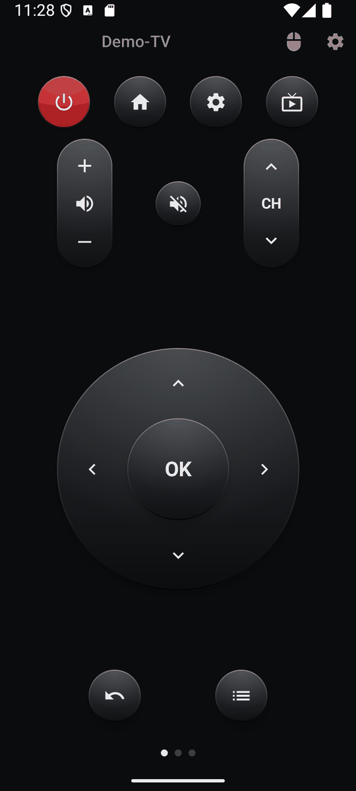
  &nbsp;
  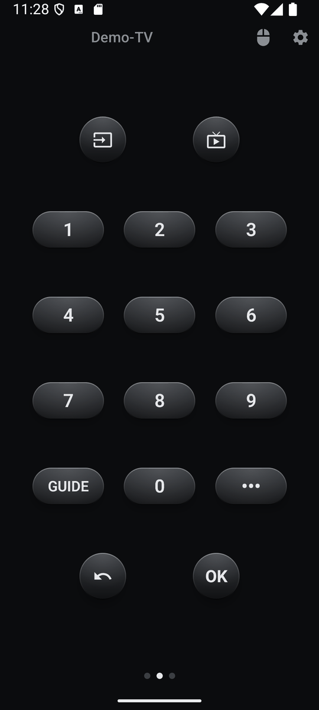
  &nbsp;
  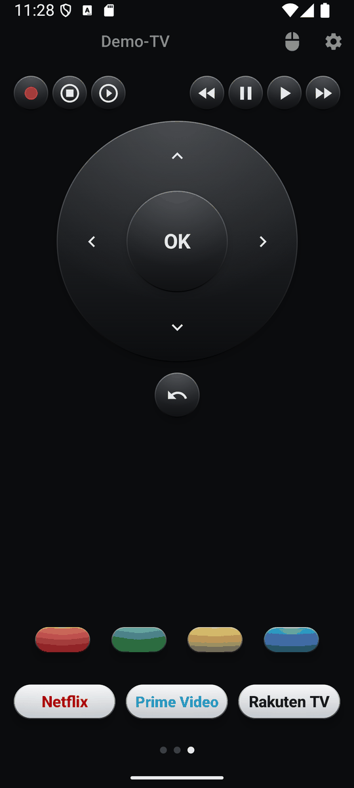
</p>

## Inhalt

1. [Funktionen im Überblick](#1-funktionen-im-ueberblick)
2. [Voraussetzungen](#2-voraussetzungen)
3. [Fernseher verbinden](#3-fernseher-verbinden)
4. [Die Screens](#4-die-screens)
   - [4.1 Kopfleiste](#41-kopfleiste)
   - [4.2 Navigation](#42-navigation)
   - [4.3 Zahlen](#43-zahlen)
   - [4.4 Media und Apps](#44-media-und-apps)
   - [4.5 Eigener Screen](#45-eigener-screen)
5. [Zeiger](#5-zeiger)
   - [5.1 Bewegungsmodus](#51-bewegungsmodus)
   - [5.2 Touchpad-Modus](#52-touchpad-modus)
6. [Screens bearbeiten](#6-screens-bearbeiten)
   - [6.1 Editor](#61-editor)
   - [6.2 App-Tasten](#62-app-tasten)
7. [Widgets](#7-widgets)
8. [Einstellungen](#8-einstellungen)
   - [8.1 Fernseher](#81-fernseher)
   - [8.2 Screens](#82-screens)
   - [8.3 Zeiger](#83-zeiger)
   - [8.4 Vibration und Demo-Modus](#84-vibration-und-demo-modus)
   - [8.5 Version und Datenschutz](#85-version-und-datenschutz)
9. [Bauen](#9-bauen)
10. [Releases](#10-releases)

## 1 Funktionen im Ueberblick

- Tasten der LG Magic Remote auf bis zu vier Screens, die ohne Scrollen auskommen – gewechselt wird per Wischen.
- Alle Screens frei belegbar: Tasten, Wippen, Steuerkreuz und App-Tasten im Editor platzieren, verschieben und in der Größe ändern; jeder Screen lässt sich auf seine Standardbelegung zurücksetzen.
- Dunkles Design mit dreidimensionalen Tasten und optionalem Vibrationsfeedback.
- Statusleuchte in der Kopfleiste, die zeigt, ob der Fernseher erreichbar ist.
- Zeiger wie bei der Magic Remote: Steuerung durch Bewegen des Handys oder über eine Touch-Fläche (Touchpad oder analoger Joystick).
- App-Tasten, die eine App am Fernseher öffnen, mit dem App-Icon vom Fernseher.
- Eingangsauswahl mit den Eingängen, die der Fernseher meldet.
- Bildschirm des Fernsehers aus- und wieder einschalten, während der Ton weiterläuft.
- Sechs kleine Homescreen-Widgets, frei kombinierbar.
- Fernseher im Netzwerk suchen, koppeln, per Wake-on-LAN einschalten.
- Demo-Modus zum Ausprobieren ohne LG-Fernseher.
- Verfügbar auf Deutsch und Englisch.

## 2 Voraussetzungen

- Android 9 (API 28) oder neuer. Die Widgets übernehmen ab Android 12 die Farben des Hintergrundbilds (Material You).
- LG-Fernseher mit webOS im selben Netzwerk wie das Handy.
- Zum Einschalten des Fernsehers: Am Fernseher muss die Option „Über WLAN einschalten“ (bei manchen Modellen „Mobile TV On“) aktiviert sein.

## 3 Fernseher verbinden

Beim ersten Start öffnet Elgy den Verbindungs-Screen:

1. **Suchen** – Elgy sucht LG-Fernseher im lokalen Netzwerk. Gefundene Fernseher erscheinen mit Name, Modell und IP-Adresse.
2. **IP-Adresse eingeben** – findet die Suche nichts, lässt sich die IP-Adresse des Fernsehers manuell eingeben.
3. **Koppeln** – Fernseher auswählen und die Verbindungsanfrage am Fernseher bestätigen. Elgy merkt sich den Fernseher, das ist also nur einmal nötig.

Es lassen sich mehrere Fernseher koppeln; der aktive Fernseher wird in der Liste ausgewählt. Elgy merkt sich außerdem die Netzwerkadresse (MAC) des Fernsehers, um ihn später einschalten zu können.

## 4 Die Screens

Die folgenden Abschnitte beschreiben die Standardbelegung. Jeder Screen lässt sich im [Editor](#61-editor) frei umgestalten.

### 4.1 Kopfleiste

Die Kopfleiste ist auf jedem Screen sichtbar:

- **Statusleuchte und Name des Fernsehers** – die Leuchte zeigt den Verbindungszustand: grün verbunden, rot nicht erreichbar, grau wird geprüft, gelb Demo-Modus. Solange die App sichtbar ist, wird die Verbindung alle 10 Sekunden geprüft, außerdem nach jedem Befehl. Ein Tippen auf den Namen öffnet den Verbindungs-Screen (suchen, koppeln, Fernseher wechseln).
- **Zeiger-Taste** (Maus-Symbol) – öffnet den Zeiger, siehe [Zeiger](#5-zeiger). Solange der Zeiger aktiv ist, ist das Symbol eingefärbt.
- **Zahnrad** – öffnet die Einstellungen der App.

Die Punkte unten zeigen den aktuellen Screen. Gewechselt wird durch Wischen nach links oder rechts. Tasten lösen erst beim Loslassen aus – ein Wisch, der auf einer Taste beginnt, sendet also nichts. Lautstärke, Kanal und das Steuerkreuz wiederholen beim Gedrückthalten.

### 4.2 Navigation


| Taste | Funktion |
|---|---|
| Ein/Aus (rot) | Schaltet den Fernseher aus; ist er nicht erreichbar, wird er per Wake-on-LAN eingeschaltet. |
| Home | Startseite von webOS. |
| Zahnrad | Einstellungen des Fernsehers. |
| Live-TV (Fernseher mit Antenne) | Wechselt zum Fernsehempfang (Antenne, Kabel, Satellit). |
| Lautstärke-Wippe | Lauter / leiser. |
| Stumm | Ton aus / an. |
| CH-Wippe | Kanal hoch / runter. |
| Steuerkreuz und OK | Navigation und Bestätigen. |
| Zurück | Einen Schritt zurück. |
| Bildschirm aus / an | Schaltet nur den Bildschirm des Fernsehers aus bzw. wieder ein, der Ton läuft weiter. |
| Guide | Programmführer. |

### 4.3 Zahlen


| Taste | Funktion |
|---|---|
| Eingang | Öffnet eine Liste der Eingänge des Fernsehers (z. B. HDMI 1, HDMI 2) und schaltet auf den gewählten um. Eingänge ohne angeschlossenes Gerät sind gekennzeichnet. |
| Live-TV | Wechselt zum Fernsehempfang. |
| 0–9 | Zifferntasten, z. B. für Kanalnummern. |
| GUIDE | Programmführer. |
| ••• | Öffnet das Menü „Weitere Aktionen“ des Fernsehers. |
| Zurück, OK | Einen Schritt zurück / Bestätigen. |

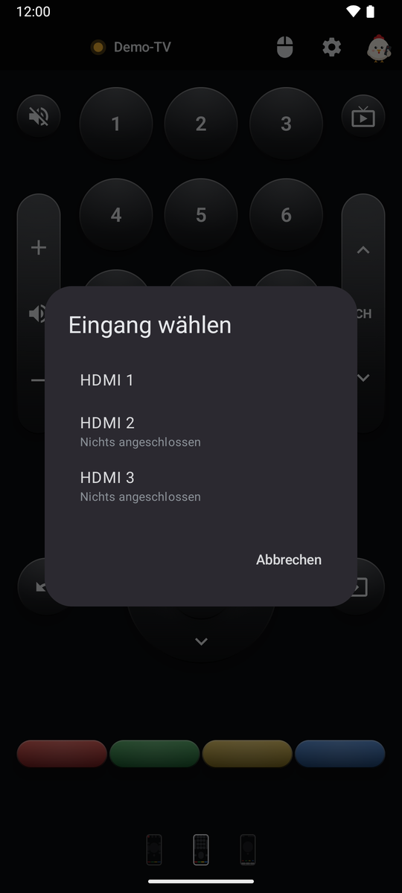

### 4.4 Media und Apps


| Taste | Funktion |
|---|---|
| Aufnahme (roter Punkt) | Startet eine Aufnahme (sofern vom Fernseher unterstützt). |
| Stopp | Beendet die Wiedergabe. |
| Zurückspulen, Pause, Play, Vorspulen | Steuerung der Wiedergabe. |
| Steuerkreuz, OK, Zurück | Navigation wie auf dem ersten Screen. |
| Farbtasten | Rot, Grün, Gelb, Blau. |
| App-Tasten | Öffnen eine App am Fernseher, vorbelegt mit Netflix, Prime Video und Rakuten TV, siehe [App-Tasten](#62-app-tasten). |

### 4.5 Eigener Screen

Der vierte Screen ist zunächst leer und ausgeblendet. Er wird in den Einstellungen unter [Screens](#82-screens) eingeblendet und im [Editor](#61-editor) belegt.

## 5 Zeiger

Die Zeiger-Taste in der Kopfleiste öffnet ein Overlay über dem aktuellen Screen. In beiden Modi gilt:

- **OK** klickt an der Zeigerposition – mehrere Klicks hintereinander sind möglich.
- Der **Beenden-Button** (×) oben rechts oder die Zurück-Geste beendet den Zeiger-Modus; der Cursor am Fernseher verschwindet.
- Nach 5 Sekunden ohne Aktivität endet der Zeiger-Modus automatisch.

### 5.1 Bewegungsmodus

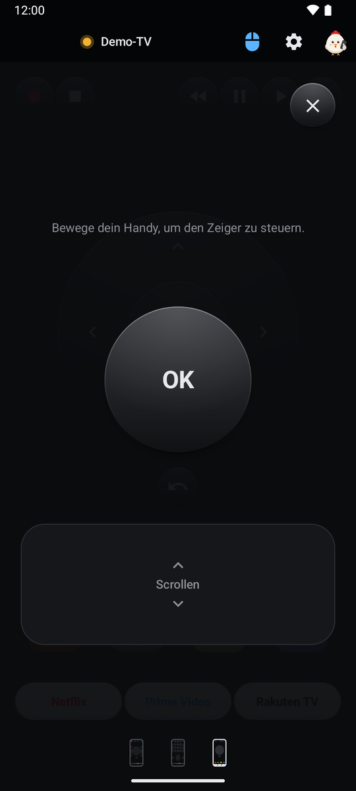

Der Zeiger folgt den Bewegungen des Handys – wie beim Zielen mit der Magic Remote. Zwei Haltungen werden unterstützt und automatisch erkannt:

- **Wie eine Fernbedienung** (Bildschirm nach oben, Oberkante zeigt zum Fernseher): links/rechts schwenken, Oberkante hoch/runter kippen.
- **Hochkant vor dem Körper** (Rückseite zeigt zum Fernseher): um die senkrechte Achse nach links/rechts drehen, nach vorne/hinten kippen.

Ein Verdrehen des Handys um die Zeigerichtung wird bewusst ignoriert, weil es beim Zielen unbewusst passiert. Die Sensordaten werden geglättet; schnelle Schwenks bewegen den Zeiger weiter als langsame Bewegungen. Auf der **Scroll-Fläche** wird durch Wischen nach oben oder unten gescrollt.

### 5.2 Touchpad-Modus

<p>
  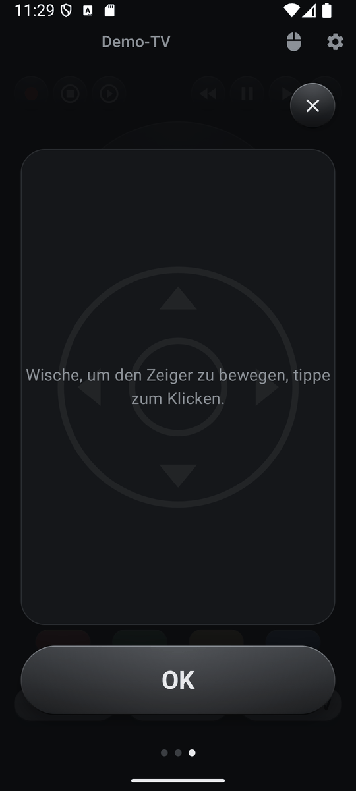
  &nbsp;
  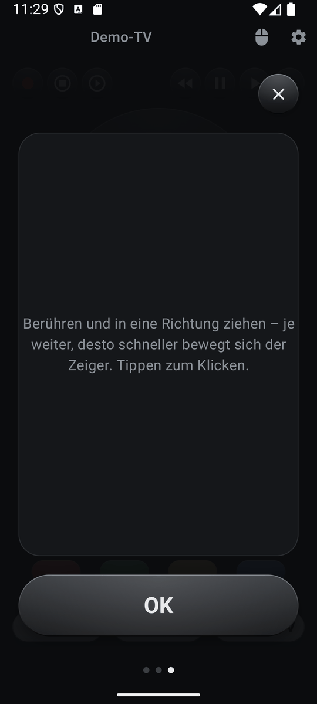
</p>

Der Zeiger wird über die Touch-Fläche gesteuert. Ein Tippen auf die Fläche ohne Wischen klickt wie OK. Zwei Eingabearten stehen zur Wahl:

- **Wischen** – der Zeiger folgt dem Finger wie auf dem Touchpad eines Laptops.
- **Joystick** – wie ein analoger Stick: Der Zeiger bewegt sich umso schneller, je weiter man in eine Richtung zieht. *Frei positionierbar*: Der Stick beginnt am ersten Berührungspunkt. *Fixiert*: Der Stick ist immer sichtbar in der Mitte der Fläche. In beiden Fällen ist die Deadzone als innerer Kreis eingezeichnet; innerhalb davon bewegt sich der Zeiger nicht.

Der OK-Button lässt sich unten (Standard) oder oben platzieren.

## 6 Screens bearbeiten

### 6.1 Editor

Der Editor wird in den Einstellungen unter [Screens](#82-screens) über den Stift eines Screens geöffnet. Er zeigt das Raster des Screens (24 × 48 Felder) in den Proportionen des Fernbedienungs-Screens.

- **Element** (unten) fügt ein Element hinzu: Lautstärke-Wippe, Kanal-Wippe, Steuerkreuz, App-Taste oder eine beliebige Taste der Fernbedienung. Das Element wird auf den ersten freien Platz gesetzt.
- **Ziehen** verschiebt ein Element.
- **Antippen** wählt ein Element aus; dann ändert der Griff an der Ecke die Größe.
- **Auf den Papierkorb ziehen** entfernt ein Element.
- **Zurücksetzen** stellt nach einer Rückfrage die Standardbelegung des Screens wieder her.
- **Fertig** speichert und schließt den Editor.

Die Belegung wird pro Fernseher gespeichert.

### 6.2 App-Tasten

<p>
  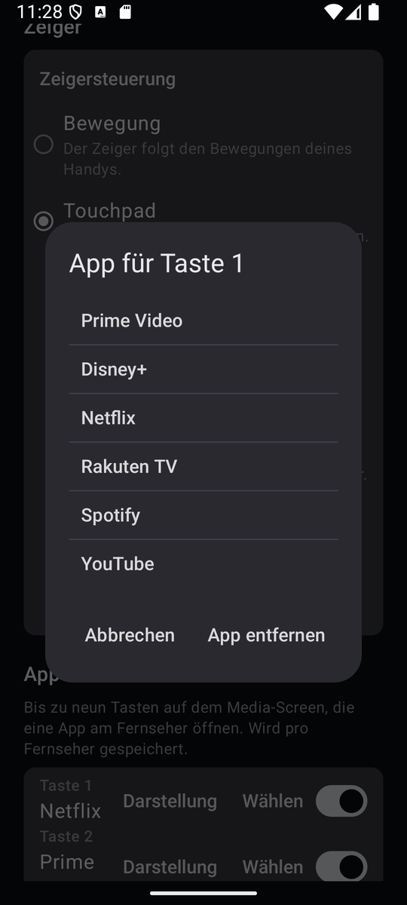
  &nbsp;
  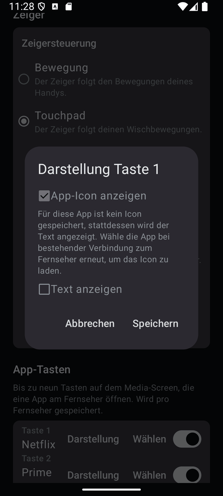
</p>

App-Tasten werden im Editor platziert. Eine App-Taste **2 Sekunden gedrückt halten** öffnet das Fenster „App-Taste“ mit einer Vorschau:

- **App auswählen** – lädt die auf dem Fernseher installierten Apps und weist eine davon zu. Das App-Icon wird vom Fernseher geladen und auf dem Handy gespeichert, damit es auch ohne Verbindung angezeigt wird. *App entfernen* leert die Taste.
- **Darstellung** – App-Icon und/oder Text anzeigen, eigenen Text eingeben (mit dem App-Namen vorbelegt) und eine Textfarbe wählen. Mit Icon und Text steht das Icon links, der Text folgt dahinter. Der Text verkleinert sich automatisch, damit er immer in die Taste passt.

Die Änderungen werden mit OK übernommen. Fehlt einer App-Taste das Icon, lädt Elgy es nach, sobald eine Verbindung zum Fernseher besteht – auch nach dem Zurücksetzen eines Screens.

## 7 Widgets

Elgy bringt sechs kleine Homescreen-Widgets mit, die sich beliebig kombinieren lassen:

| Widget | Größe | Tasten |
|---|---|---|
| Elgy Lautstärke | 1 × 2, Höhe veränderbar | Lauter / leiser |
| Elgy Kanal | 1 × 2, Höhe veränderbar | Kanal hoch / runter |
| Elgy Wiedergabe | 3 × 1, Breite veränderbar | Zurückspulen, Play, Pause, Vorspulen, Stopp |
| Elgy Ein/Aus | 1 × 1 | Ein/Aus |
| Elgy Stumm | 1 × 1 | Stumm |
| Elgy Bildschirm | 2 × 1, Breite veränderbar | Bildschirm aus / an |

- Ein Widget steuert den Fernseher, der in der App aktiv ist. Über **Widgeteinstellungen** (Widget gedrückt halten) lässt es sich fest an einen bestimmten Fernseher binden.
- Die App muss nicht geöffnet sein. Ein Tastendruck vibriert, wenn [Vibration bei Tastendruck](#84-vibration-und-demo-modus) eingeschaltet ist; ist der Fernseher nicht erreichbar, erscheint ein Hinweis.
- Die Widgets übernehmen ab Android 12 die Farben des Hintergrundbilds und passen sich dem hellen und dunklen Design an.

## 8 Einstellungen

### 8.1 Fernseher

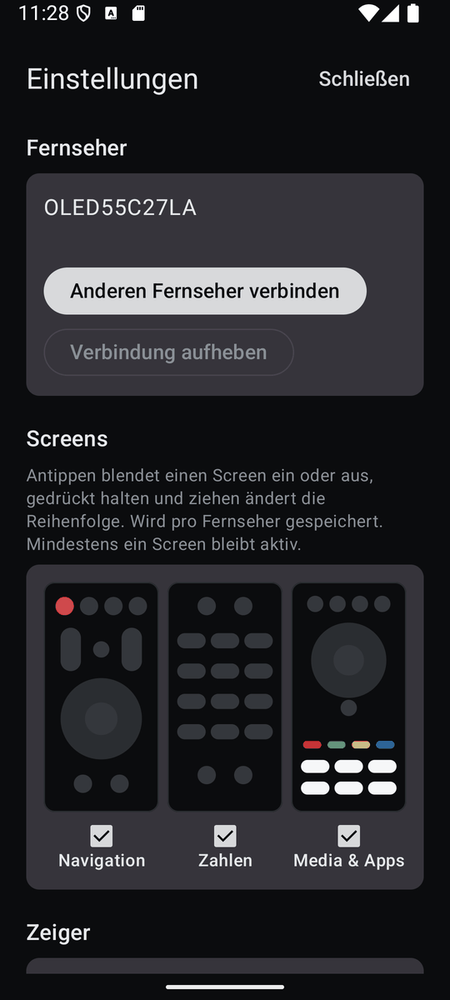

Zeigt den aktiven Fernseher. **Anderen Fernseher verbinden** öffnet den Verbindungs-Screen, **Verbindung aufheben** entfernt den aktiven Fernseher nach einer Rückfrage.

### 8.2 Screens

Die vier Screens werden als Vorschaubilder ihrer aktuellen Belegung angezeigt:

- **Antippen** blendet einen Screen ein oder aus.
- **Gedrückt halten und ziehen** ändert die Reihenfolge.
- **Stift** öffnet den [Editor](#61-editor).
- **Pfeil** setzt den Screen nach einer Rückfrage auf seine Standardbelegung zurück.
- Mindestens ein Screen bleibt immer aktiv. Ist nur ein Screen aktiv, verschwinden die Seitenpunkte.

Die Auswahl wird pro Fernseher gespeichert.

### 8.3 Zeiger

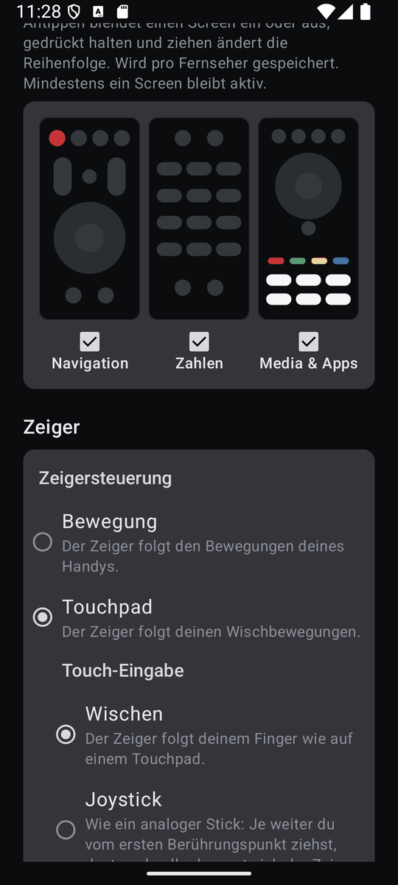

- **Bewegung** – mit den Unteroptionen *Empfindlichkeit* (0,3× bis 3,0×) und *Beschleunigung* (0× bis 4×; 0 = keine Beschleunigung). Nur verfügbar, wenn das Handy ein Gyroskop hat.
- **Touchpad** – mit den Unteroptionen *Touch-Eingabe* (Wischen oder Joystick, beim Joystick mit *Joystick-Position* frei positionierbar oder fixiert) und *OK-Button* (unten oder oben).

### 8.4 Vibration und Demo-Modus

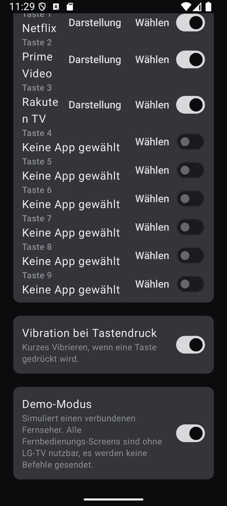

- **Vibration bei Tastendruck** – kurzes Vibrieren beim Drücken einer Taste (auch beim Klicken im Touchpad-Modus und bei den Widgets).
- **Demo-Modus** – simuliert einen verbundenen Fernseher („Demo-TV“, gelbe Statusleuchte). Alle Screens sind ohne LG-Fernseher nutzbar, es werden keine Befehle gesendet. Der Demo-Modus hat eine eigene Screen-Belegung und eine eigene Screen-Auswahl.

### 8.5 Version und Datenschutz

Am unteren Rand der Einstellungen stehen fest die Versionsnummer (links) und der Link **Datenschutz** (rechts), der die Datenschutzerklärung öffnet.

## 9 Bauen

```
./gradlew :app:assembleDebug
```

Benötigt JDK 17 oder neuer und das Android SDK.

## 10 Releases

APKs werden automatisch auf GitHub gebaut:

- Tag `v*` → signiertes Release-APK und App Bundle, veröffentlicht als GitHub-Release.
- Tag `devbuild` → signiertes APK als Build-Artefakt.
