<p align="center">
  
</p>

# Elly

Elly macht dein Android-Handy zur Fernbedienung für LG-Fernseher mit webOS. Die App bildet die Tasten und Funktionen der originalen LG Magic Remote nach – einschließlich des Zeigers, der sich über die Bewegungssensoren des Handys oder eine Touch-Fläche steuern lässt. Durch die App begleitet dich Elly, ein Huhn mit einer Fernbedienung im Flügel.

> **Status:** frühe Entwicklung – Suchen und Koppeln, alle Tasten, der Zeiger, frei belegbare Screens, Widgets und die Hilfe funktionieren; einzelne Tastenbelegungen müssen noch an weiteren Fernsehern geprüft werden.

> Elly ist ein unabhängiges Projekt und steht in keiner Verbindung zu LG Electronics. „LG“, „webOS“ und „Magic Remote“ sind Marken ihrer jeweiligen Inhaber.

[English version](README.md)

<p>
  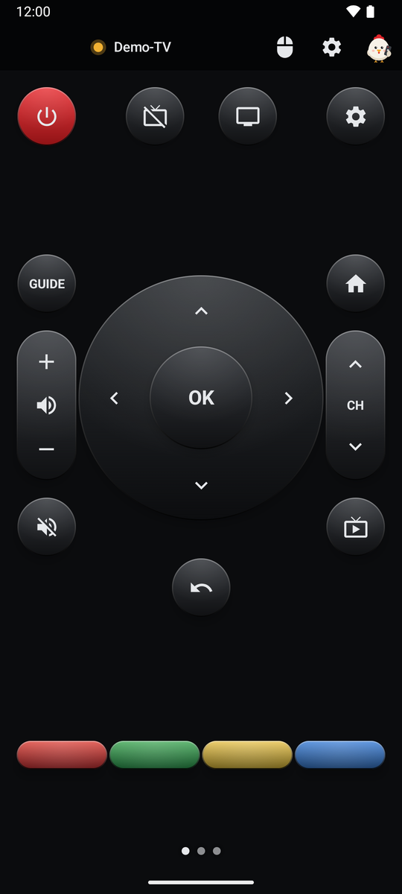
  &nbsp;
  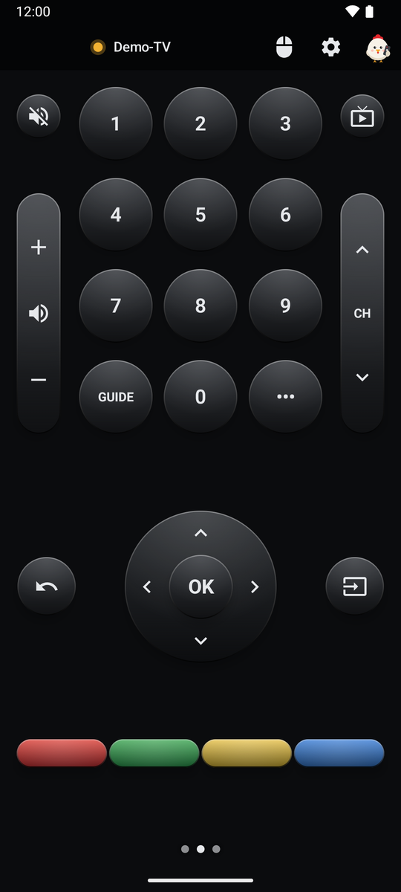
  &nbsp;
  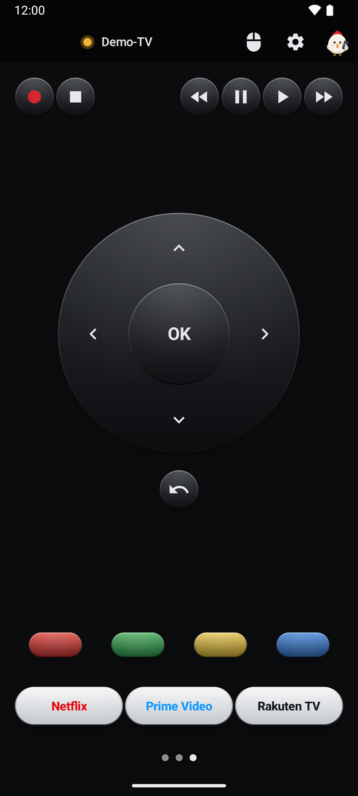
</p>

## Inhalt

1. [Funktionen im Überblick](#1-funktionen-im-ueberblick)
2. [Voraussetzungen](#2-voraussetzungen)
3. [Erste Schritte](#3-erste-schritte)
   - [3.1 Schnelleinstieg](#31-schnelleinstieg)
   - [3.2 Fernseher verbinden](#32-fernseher-verbinden)
4. [Die Fernbedienung](#4-die-fernbedienung)
   - [4.1 Kopfleiste](#41-kopfleiste)
   - [4.2 Screen 1](#42-screen-1)
   - [4.3 Screen 2](#43-screen-2)
   - [4.4 Screen 3](#44-screen-3)
   - [4.5 Screen 4](#45-screen-4)
   - [4.6 Texteingabe](#46-texteingabe)
5. [Zeiger](#5-zeiger)
   - [5.1 Bewegungsmodus](#51-bewegungsmodus)
   - [5.2 Touchpad-Modus](#52-touchpad-modus)
6. [Screens bearbeiten](#6-screens-bearbeiten)
   - [6.1 Editor](#61-editor)
   - [6.2 Tastengruppen](#62-tastengruppen)
   - [6.3 App-Tasten](#63-app-tasten)
7. [Darstellung](#7-darstellung)
8. [Widgets](#8-widgets)
9. [Einstellungen](#9-einstellungen)
10. [Hilfe](#10-hilfe)
11. [Datenschutz](#11-datenschutz)
12. [Bauen](#12-bauen)
13. [Releases](#13-releases)
14. [Lizenz](#14-lizenz)

## 1 Funktionen im Ueberblick

- Tasten der LG Magic Remote auf bis zu vier Screens, die ohne Scrollen auskommen – gewechselt wird per Wischen.
- Alle Screens frei belegbar: Tasten, Wippen, Steuerkreuz und App-Tasten im Editor platzieren, verschieben, in der Größe ändern, gruppenweise einfügen und Schritt für Schritt rückgängig machen.
- Zeiger wie bei der Magic Remote: Steuerung durch Bewegen des Handys oder über eine Touch-Fläche (Wischen oder Joystick), auf Wunsch per Schütteln oder Doppeltipp geöffnet.
- Texteingabe: Ist am Fernseher ein Eingabefeld aktiv, öffnet sich auf dem Handy automatisch ein Textfeld.
- App-Tasten, die eine App am Fernseher öffnen, mit dem App-Icon vom Fernseher.
- Eingangsauswahl mit den Eingängen, die der Fernseher meldet.
- Bildschirm des Fernsehers aus- und wieder einschalten, während der Ton weiterläuft.
- 15 Farbpaletten, zwölf Hintergründe (auch ein eigenes Foto), einstellbare Rundung und der Lichteffekt „Lange Sommerabende“.
- Sieben Homescreen-Widgets, darunter „Elly Fernbedienung“ mit frei wählbaren Tasten und eigener Optik.
- Statusleuchte in der Kopfleiste, die zeigt, ob der Fernseher erreichbar ist.
- Schnelleinstieg beim ersten Start und eine ausführliche Hilfe mit Suche – erklärt von Elly.
- Fernseher im Netzwerk suchen, koppeln, per Wake-on-LAN einschalten.
- Demo-Modus zum Ausprobieren ohne LG-Fernseher.
- Verfügbar auf Deutsch und Englisch.

## 2 Voraussetzungen

- Android 9 (API 28) oder neuer. Die Widgets übernehmen ab Android 12 die Farben des Hintergrundbilds (Material You); der Lichteffekt ist ab Android 12 verfügbar.
- LG-Fernseher mit webOS im selben Netzwerk wie das Handy.
- Zum Einschalten des Fernsehers: Am Fernseher muss die Option „Über WLAN einschalten“ (bei manchen Modellen „Mobile TV On“) aktiviert sein.

## 3 Erste Schritte

### 3.1 Schnelleinstieg

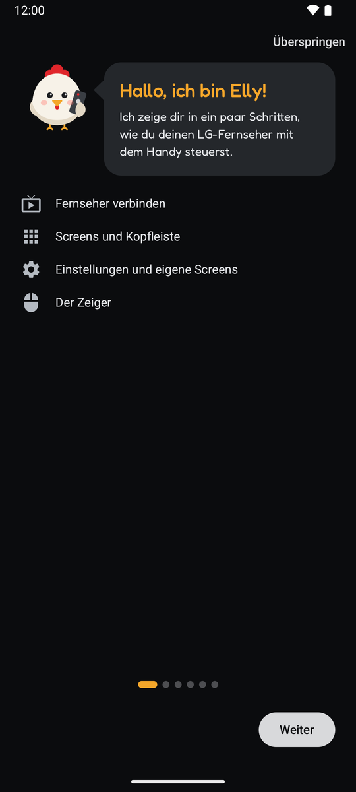

Beim ersten Start stellt sich Elly vor und zeigt in sechs kurzen Seiten das Wichtigste: Fernseher verbinden, Screens und Kopfleiste, Einstellungen und eigene Screens sowie den Zeiger. Mit **Überspringen** geht es direkt los. Der Schnelleinstieg lässt sich jederzeit über die [Hilfe](#10-hilfe) erneut starten.

### 3.2 Fernseher verbinden

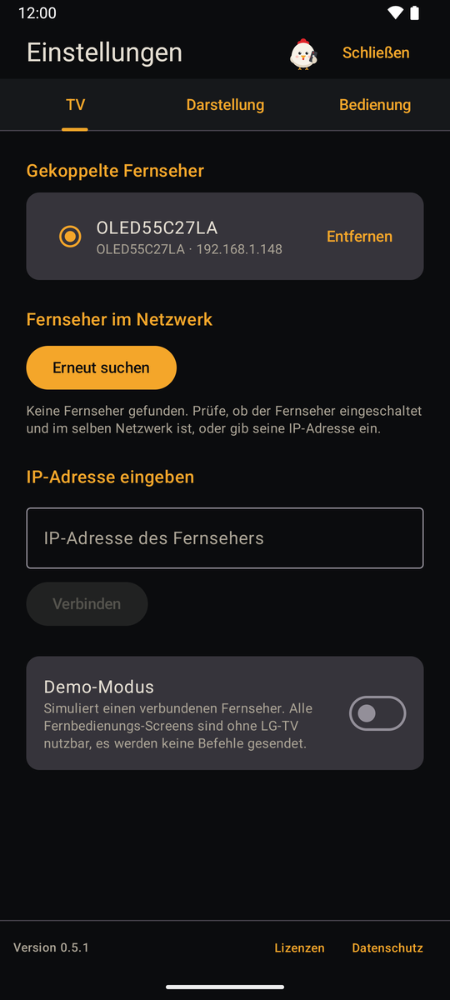

Ist noch kein Fernseher gekoppelt, öffnet Elly die Einstellungen im Reiter **TV** und sucht sofort im lokalen Netzwerk:

1. **Suchen** – gefundene Fernseher erscheinen mit Name, Modell und IP-Adresse. **Erneut suchen** startet die Suche noch einmal.
2. **IP-Adresse eingeben** – findet die Suche nichts, lässt sich die IP-Adresse des Fernsehers manuell eingeben.
3. **Koppeln** – Fernseher antippen und die Verbindungsanfrage am Fernseher bestätigen. Das ist nur einmal nötig; Elly meldet die erfolgreiche Kopplung und wechselt zur Fernbedienung.

Es lassen sich mehrere Fernseher koppeln. Sie stehen oben im Reiter unter **Gekoppelte Fernseher**: Antippen macht einen Fernseher zum aktiven, **Entfernen** löst die Kopplung nach einer Rückfrage. Elly merkt sich außerdem die Netzwerkadresse (MAC) des Fernsehers, um ihn später einschalten zu können. Den Reiter **TV** erreichst du jederzeit über den Fernseher-Namen in der Kopfleiste. Solange der Demo-Modus an ist, zeigt der Reiter nur den Schalter für den Demo-Modus.

## 4 Die Fernbedienung

Die folgenden Abschnitte beschreiben die Standardbelegung. Jeder Screen lässt sich im [Editor](#61-editor) frei umgestalten.

### 4.1 Kopfleiste

Die Kopfleiste ist auf jedem Screen sichtbar:

- **Statusleuchte und Name des Fernsehers** – die Leuchte zeigt den Verbindungszustand: grün verbunden, rot nicht erreichbar, grau wird geprüft, gelb Demo-Modus. Solange die App sichtbar ist, wird die Verbindung alle 10 Sekunden geprüft, außerdem nach jedem Befehl. Ein Tippen auf den Namen öffnet die Einstellungen im Reiter **TV**.
- **Zeiger-Taste** (Maus-Symbol) – öffnet den [Zeiger](#5-zeiger). Solange er aktiv ist, ist das Symbol blau.
- **Zahnrad** – öffnet die [Einstellungen](#9-einstellungen).
- **Elly** ganz rechts – öffnet die [Hilfe](#10-hilfe). Zu Weihnachten (24.12. bis 06.01.), zu Ostern (Palmsonntag bis zum Sonntag nach Ostern) und vor Halloween (24. bis 31.10.) trägt sie ein passendes Kostüm.

Die Punkte unten zeigen den aktuellen Screen; gewechselt wird durch Wischen nach links oder rechts. Tasten lösen erst beim Loslassen aus – ein Wisch, der auf einer Taste beginnt, sendet also nichts. Lautstärke, Kanal und das Steuerkreuz wiederholen beim Gedrückthalten.

### 4.2 Screen 1


| Taste | Funktion |
|---|---|
| Ein/Aus (rot) | Schaltet den Fernseher aus; ist er nicht erreichbar, wird er per Wake-on-LAN eingeschaltet. |
| Bildschirm aus / an | Schaltet nur den Bildschirm aus bzw. wieder ein, der Ton läuft weiter. |
| Zahnrad | Einstellungen des Fernsehers. |
| GUIDE | Programmführer. |
| Home | Startseite von webOS. |
| Lautstärke-Wippe, Stumm | Lauter / leiser, Ton aus / an. |
| CH-Wippe | Kanal hoch / runter. |
| Steuerkreuz und OK | Navigation und Bestätigen. |
| Live-TV | Wechselt zum Fernsehempfang (Antenne, Kabel, Satellit). |
| Zurück | Einen Schritt zurück. |
| Farbtasten | Rot, Grün, Gelb, Blau. |

### 4.3 Screen 2

<p>
  
  &nbsp;
  
</p>

| Taste | Funktion |
|---|---|
| 0–9 | Zifferntasten, z. B. für Kanalnummern. |
| Stumm, Live-TV | Ton aus / an, Fernsehempfang. |
| Lautstärke- und CH-Wippe | Lauter / leiser, Kanal hoch / runter. |
| GUIDE | Programmführer. |
| ••• | Öffnet das Menü „Weitere Aktionen“ des Fernsehers. |
| Steuerkreuz, Zurück | Navigation wie auf Screen 1. |
| Eingang | Öffnet eine Liste der Eingänge des Fernsehers (z. B. HDMI 1, HDMI 2) und schaltet auf den gewählten um. Eingänge ohne angeschlossenes Gerät sind gekennzeichnet. |
| Farbtasten | Rot, Grün, Gelb, Blau. |

### 4.4 Screen 3


| Taste | Funktion |
|---|---|
| Aufnahme (roter Punkt), Stopp | Startet eine Aufnahme (sofern vom Fernseher unterstützt) bzw. beendet die Wiedergabe. |
| Zurückspulen, Pause, Wiedergabe, Vorspulen | Steuerung der Wiedergabe. |
| Steuerkreuz, Zurück | Navigation wie auf Screen 1. |
| Farbtasten | Rot, Grün, Gelb, Blau. |
| App-Tasten | Öffnen eine App am Fernseher, vorbelegt mit Netflix, Prime Video und Rakuten TV, siehe [App-Tasten](#63-app-tasten). |

### 4.5 Screen 4

Der vierte Screen ist zunächst leer und ausgeblendet. Er wird in den Einstellungen unter **Darstellung → Screens** eingeblendet und im [Editor](#61-editor) belegt.

### 4.6 Texteingabe

Ist am Fernseher ein Eingabefeld aktiv (z. B. eine Suche), öffnet sich auf dem Handy automatisch ein Textfeld mit der Tastatur des Handys. Der Text wird während des Tippens übertragen, die Senden-Taste wirkt wie Enter. Über die Taste **Tastatur**, die sich im Editor auf einen Screen legen lässt, öffnest du das Textfeld auch von Hand. Apps mit eigener Bildschirmtastatur (z. B. manche Streaming-Apps) nehmen keinen Text vom Handy an.

## 5 Zeiger

Die Zeiger-Taste in der Kopfleiste öffnet ein Overlay über dem aktuellen Screen – am Fernseher erscheint der Cursor der Magic Remote. In beiden Modi gilt:

- **OK** klickt an der Zeigerposition, mehrere Klicks hintereinander sind möglich.
- Das **×** oben rechts oder die Zurück-Geste beendet den Zeiger; der Cursor am Fernseher verschwindet.
- Nach 5 Sekunden ohne Aktivität endet der Zeiger automatisch.

Den Modus und alle Feineinstellungen wählst du in den Einstellungen im Reiter **Bedienung**.

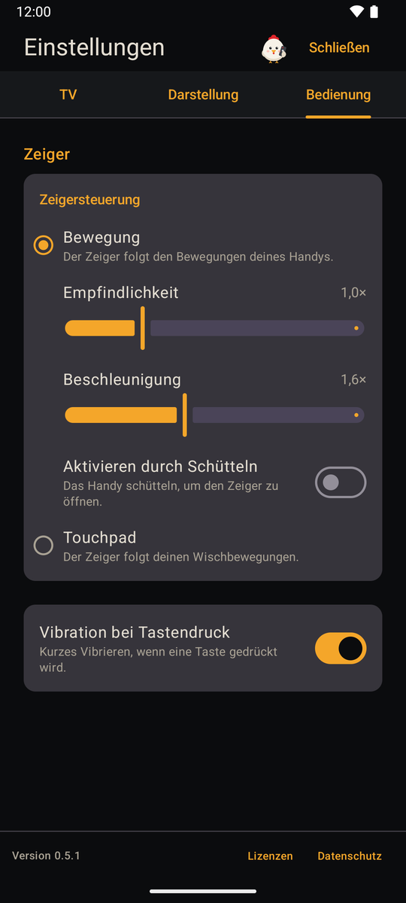

### 5.1 Bewegungsmodus


Der Zeiger folgt den Bewegungen des Handys – wie beim Zielen mit der Magic Remote. Zwei Haltungen werden automatisch erkannt:

- **Wie eine Fernbedienung** (Bildschirm nach oben, Oberkante zeigt zum Fernseher): links/rechts schwenken, Oberkante hoch/runter kippen.
- **Hochkant vor dem Körper** (Rückseite zeigt zum Fernseher): nach links/rechts drehen, nach vorne/hinten kippen.

Ein Verdrehen des Handys um die Zeigerichtung wird ignoriert, damit der Cursor ruhig bleibt. *Empfindlichkeit* (0,3× bis 3,0×) und *Beschleunigung* (0× bis 4×) lassen sich einstellen. Auf der **Scroll-Fläche** wird durch Wischen nach oben oder unten gescrollt. Mit **Aktivieren durch Schütteln** öffnet ein kurzes Schütteln des Handys den Zeiger; die Schüttel-Empfindlichkeit ist einstellbar. Der Bewegungsmodus braucht ein Gyroskop im Handy.

### 5.2 Touchpad-Modus

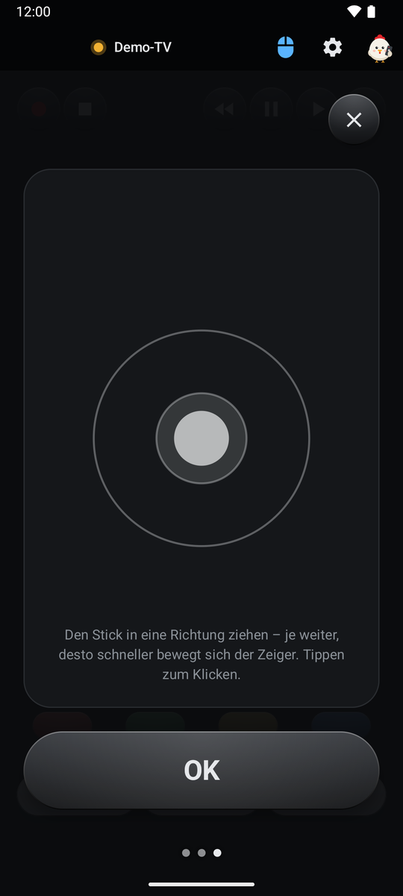

Der Zeiger wird über eine Touch-Fläche gesteuert, ein kurzes Tippen klickt. Zwei Eingabearten stehen zur Wahl:

- **Wischen** – der Zeiger folgt dem Finger wie auf dem Touchpad eines Laptops; die *Geschwindigkeit* (0,3× bis 3,0×) ist einstellbar.
- **Joystick** – wie ein analoger Stick: Je weiter du ziehst, desto schneller bewegt sich der Zeiger. *Frei positionierbar*: Der Stick beginnt am ersten Berührungspunkt. *Fixiert*: Der Stick ist immer in der Mitte sichtbar. Der innere Kreis ist die Totzone.

Der OK-Button lässt sich unten (Standard) oder oben platzieren. Mit **Aktivieren durch Doppeltipp** öffnet ein Doppeltipp auf eine freie Stelle eines Screens den Zeiger.

## 6 Screens bearbeiten

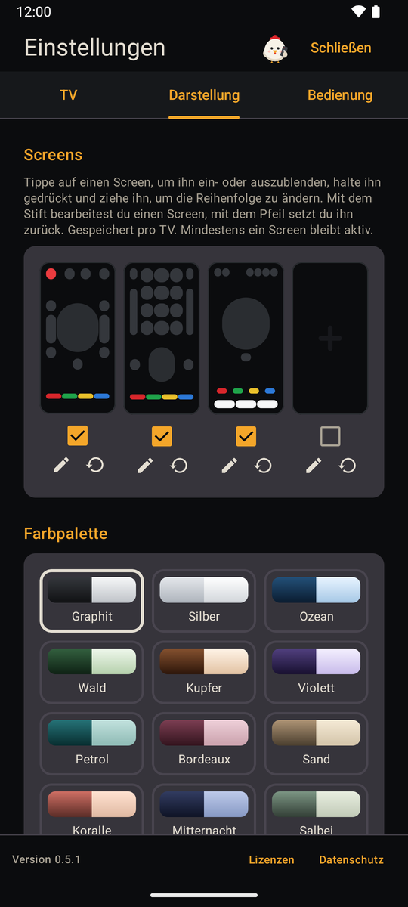

In den Einstellungen unter **Darstellung → Screens** werden die vier Screens als Vorschau ihrer Belegung angezeigt:

- **Antippen** blendet einen Screen ein oder aus; mindestens einer bleibt aktiv. Ist nur ein Screen aktiv, verschwinden die Seitenpunkte.
- **Gedrückt halten und ziehen** ändert die Reihenfolge.
- **Stift** öffnet den [Editor](#61-editor), **Pfeil** setzt den Screen nach einer Rückfrage auf seine Standardbelegung zurück.

Auswahl und Belegung werden pro Fernseher gespeichert; der Demo-Modus hat eigene.

### 6.1 Editor

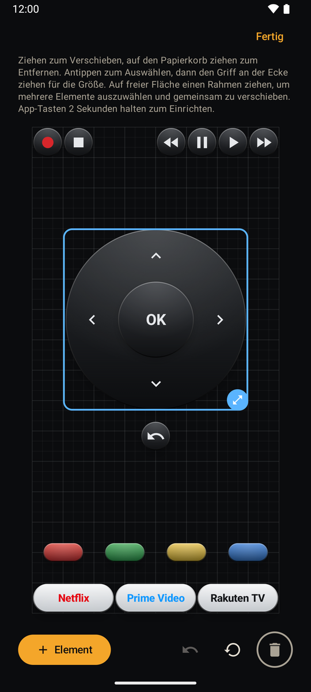

Der Editor zeigt das Raster des Screens (24 × 48 Felder) in den Proportionen des Fernbedienungs-Screens.

- **Element** fügt eine einzelne Taste, eine Wippe, das Steuerkreuz, eine App-Taste oder eine [Tastengruppe](#62-tastengruppen) hinzu; sie landet auf dem ersten freien Platz.
- **Ziehen** verschiebt ein Element, **auf den Papierkorb ziehen** entfernt es.
- **Antippen** wählt ein Element aus; dann ändert der Griff an der Ecke die Größe.
- **Rahmen ziehen** auf freier Fläche wählt mehrere Elemente aus, die sich gemeinsam verschieben oder gemeinsam entfernen lassen.
- **Rückgängig** nimmt Hinzufügen, Verschieben, Größe, Entfernen, App-Tasten-Änderungen und Zurücksetzen Schritt für Schritt zurück (bis zu 50 Schritte; der Verlauf beginnt bei jedem Öffnen neu).
- **Zurücksetzen** stellt nach einer Rückfrage die Standardbelegung wieder her, **Fertig** speichert und schließt.

### 6.2 Tastengruppen

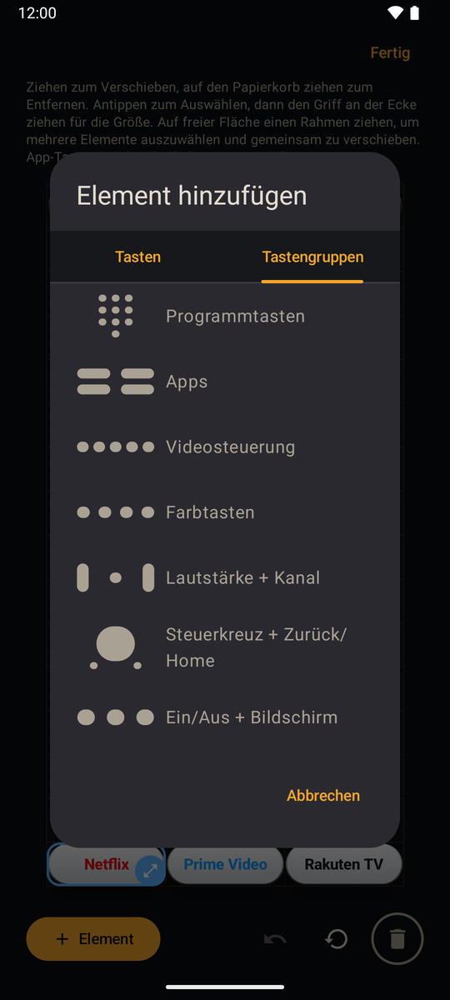

Im Reiter **Tastengruppen** fügst du mehrere Tasten auf einmal ein: Programmtasten (Ziffernblock), Apps, Videosteuerung, Farbtasten, Lautstärke + Kanal, Steuerkreuz + Zurück/Home sowie Ein/Aus + Bildschirm. Die Tasten haben die Größe einzelner Tasten, landen danach als einzelne Elemente auf dem Screen und lassen sich mittig setzen.

### 6.3 App-Tasten

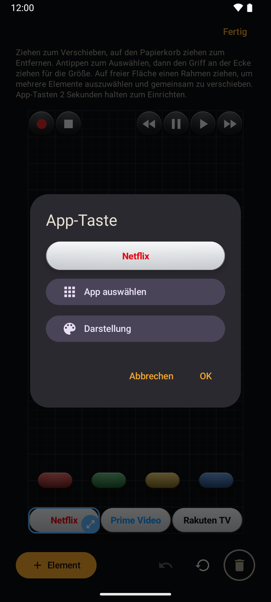

Eine App-Taste im Editor **2 Sekunden gedrückt halten** öffnet das Fenster „App-Taste“ mit einer Vorschau:

- **App auswählen** – lädt die auf dem Fernseher installierten Apps und weist eine davon zu. Das App-Icon wird vom Fernseher geladen und auf dem Handy gespeichert.
- **Darstellung** – App-Icon und/oder Text, eigener Text und Textfarbe. Der Text verkleinert sich automatisch, damit er in die Taste passt.

Fehlt einer App-Taste das Icon, lädt Elly es nach, sobald eine Verbindung zum Fernseher besteht.

## 7 Darstellung

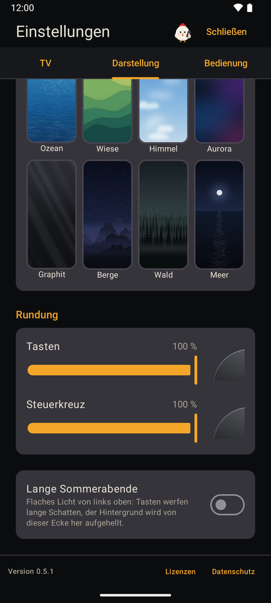

Im Reiter **Darstellung** der Einstellungen:

- **Farbpalette** – 15 Paletten färben Tasten, Wippen, Steuerkreuz und App-Tasten: Graphit, Silber, Ozean, Wald, Kupfer, Violett, Petrol, Bordeaux, Sand, Koralle, Mitternacht, Salbei, Rubin, Lagune und Bernstein. Ein/Aus und die Farbtasten behalten ihre Farbe.
- **Hintergrund** – gilt für alle Screens: Keiner, Auto (passend zur Farbpalette), Eigenes Bild aus der Fotoauswahl (proportional angepasst und angeschnitten) oder eines der Motive Hügel, Ozean, Wiese, Himmel, Aurora, Graphit, Berge, Wald und Meer.
- **Rundung** – zwei Regler mit Eck-Vorschau: „Tasten“ wirkt auf Tasten, Wippen und App-Tasten, „Steuerkreuz“ auf Ring und OK-Taste.
- **Lange Sommerabende** – flaches Licht von links oben; die Tasten werfen lange, weiche Schatten nach rechts unten, der Hintergrund wird von dieser Ecke her aufgehellt (ab Android 12).

## 8 Widgets


Elly bringt sieben Homescreen-Widgets mit:

| Widget | Größe | Tasten |
|---|---|---|
| Elly Lautstärke | 1 × 2, Höhe veränderbar | Lauter / leiser |
| Elly Kanal | 1 × 2, Höhe veränderbar | Kanal hoch / runter |
| Elly Wiedergabe | 3 × 1, Breite veränderbar | Zurückspulen, Wiedergabe, Pause, Vorspulen, Stopp |
| Elly Ein/Aus | 1 × 1 | Ein/Aus |
| Elly Stumm | 1 × 1 | Stumm |
| Elly Bildschirm | 2 × 1, Breite veränderbar | Bildschirm aus / an |
| Elly Fernbedienung | 4 × 2, frei veränderbar | Alle Tasten der übrigen Widgets |

- Beim Hinzufügen fragt Elly, welchen Fernseher das Widget steuern soll; über **Widget-Einstellungen** (Widget gedrückt halten) lässt sich das ändern.
- **Elly Fernbedienung** hat zusätzlich eigene Widget-Einstellungen: welche Tasten erscheinen, Tasten pro Reihe (2 bis 8), TV-Name anzeigen, Hintergrund der Tastenreihen sowie Farbe und Deckkraft der gemeinsamen Fläche. Das Layout ordnet sich je nach aktiven Tasten neu: Gruppen bleiben zusammen, kleine Gruppen teilen sich eine Reihe.
- Die App muss nicht geöffnet sein. Ein Tastendruck vibriert, wenn Vibration eingeschaltet ist; ist der Fernseher nicht erreichbar, erscheint ein Hinweis.
- Ab Android 12 übernehmen die Widgets die Farben des Hintergrundbilds und passen sich dem hellen und dunklen Design an.

## 9 Einstellungen

Das Zahnrad in der Kopfleiste öffnet die Einstellungen. Sie haben drei Reiter, zwischen denen du auch wischen kannst; Elly merkt sich den zuletzt geöffneten.

- **TV** – gekoppelte Fernseher, Suche, IP-Adresse und **Demo-Modus**: Er simuliert einen verbundenen Fernseher („Demo-TV“, gelbe Statusleuchte), alle Screens sind ohne LG-Fernseher nutzbar und es werden keine Befehle gesendet. Siehe [Fernseher verbinden](#32-fernseher-verbinden).
- **Darstellung** – Screens, Farbpalette, Hintergrund, Rundung, Lichteffekt. Siehe [Screens bearbeiten](#6-screens-bearbeiten) und [Darstellung](#7-darstellung).
- **Bedienung** – Zeiger (siehe [Zeiger](#5-zeiger)) und **Vibration bei Tastendruck**.

Am unteren Rand stehen fest die Versionsnummer sowie die Links **Lizenzen** (alle verwendeten Open-Source-Komponenten) und **Datenschutz**. Oben rechts öffnet Elly die Hilfe.

## 10 Hilfe

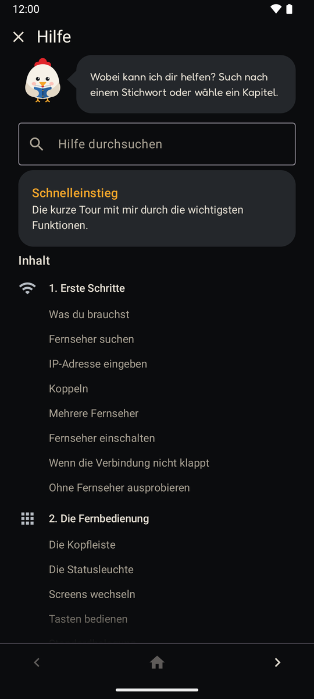

Elly ganz rechts in der Kopfleiste öffnet die Hilfe. Sie bietet:

- eine **Volltextsuche** mit hervorgehobenen Treffern,
- den **Schnelleinstieg**, der die Tour vom ersten Start erneut zeigt,
- neun Kapitel mit über 50 Themen, viele davon mit Screenshots.

Zwischen Übersicht und Kapiteln wechselst du per Wischen oder über die feste Fußleiste (vorheriges Kapitel, Übersicht, nächstes Kapitel). In jedem Kapitel begrüßt dich Elly in einer eigenen, animierten Szene – vom Lesen im Buch über die Malerin an der Staffelei bis zur Richterin im Kapitel Datenschutz. Erwähnungen der Datenschutzerklärung sind Links.

## 11 Datenschutz

Elly spricht nur mit deinem Fernseher im lokalen Netzwerk; es werden keine Daten an externe Server übertragen. Gekoppelte Fernseher, Einstellungen, Screen-Belegungen und App-Icons bleiben auf dem Handy und werden beim Deinstallieren gelöscht. Die vollständige Datenschutzerklärung steht in der App unter **Einstellungen → Datenschutz**.

## 12 Bauen

```
./gradlew :app:assembleDebug
```

Benötigt JDK 17 oder neuer und das Android SDK.

## 13 Releases

APKs werden automatisch auf GitHub gebaut:

- Tag `v*` → signiertes Release-APK und App Bundle, veröffentlicht als GitHub-Release.
- Tag `devbuild` → signiertes APK als Build-Artefakt.

## 14 Lizenz

Elly steht unter der [MIT-Lizenz](LICENSE). Die Schrift [Fredoka](https://github.com/hafontia/Fredoka-One) steht unter der SIL Open Font License 1.1; AndroidX, Jetpack Compose, Kotlin, kotlinx.coroutines und OkHttp stehen unter der Apache License 2.0. Alle Lizenztexte sind in der App unter **Einstellungen → Lizenzen** einsehbar.
