# Elgy

Elgy turns your Android phone into a remote control for LG TVs running webOS. It recreates the keys and functions of the original LG Magic Remote, including the pointer, which can be controlled with your phone's motion sensors or a touch area.

> **Status:** early development – searching for and pairing TVs, the remote keys, the pointer and the app keys work; some key assignments still need to be verified on more TVs.

[Deutsche Version](README.de.md)

<p>
  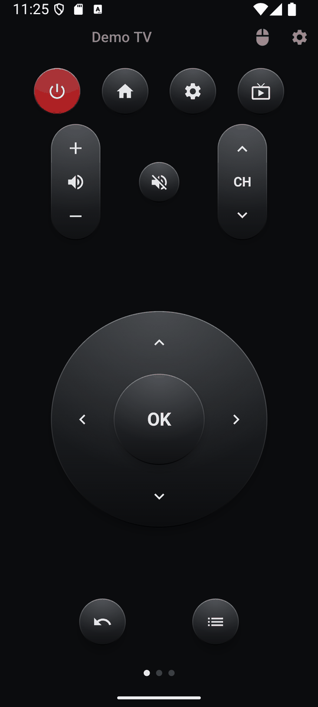
  &nbsp;
  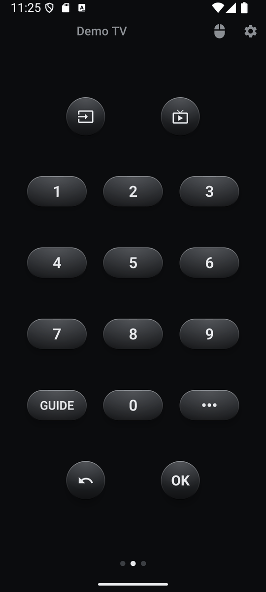
  &nbsp;
  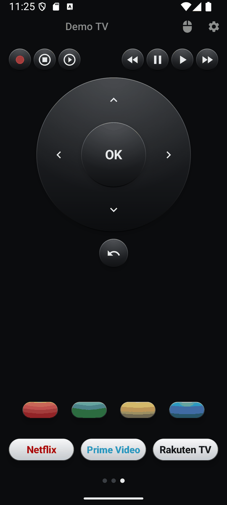
</p>

## Contents

1. [Features at a glance](#1-features-at-a-glance)
2. [Requirements](#2-requirements)
3. [Connecting a TV](#3-connecting-a-tv)
4. [The screens](#4-the-screens)
   - [4.1 Header](#41-header)
   - [4.2 Navigation](#42-navigation)
   - [4.3 Numbers](#43-numbers)
   - [4.4 Media and apps](#44-media-and-apps)
5. [Pointer](#5-pointer)
   - [5.1 Motion mode](#51-motion-mode)
   - [5.2 Touchpad mode](#52-touchpad-mode)
6. [Settings](#6-settings)
   - [6.1 TV](#61-tv)
   - [6.2 Screens](#62-screens)
   - [6.3 Pointer](#63-pointer)
   - [6.4 App keys](#64-app-keys)
   - [6.5 Vibration and demo mode](#65-vibration-and-demo-mode)
7. [Building](#7-building)
8. [Releases](#8-releases)

## 1 Features at a glance

- Keys of the LG Magic Remote on up to three screens that fit without scrolling – swipe to switch between them.
- Dark design with three-dimensional keys and optional vibration feedback.
- Pointer like the Magic Remote: controlled by moving the phone or via a touch area (touchpad or analog joystick).
- Up to nine freely configurable app keys per TV, with the app's icon loaded from the TV.
- Input picker that lists the inputs reported by the TV.
- Screens can be hidden and reordered per TV.
- Searching for TVs in the network, pairing, switching on via Wake-on-LAN.
- Demo mode to try the app without an LG TV.
- Available in English and German.

## 2 Requirements

- Android 9 (API 28) or newer.
- LG TV with webOS in the same network as the phone.
- For switching the TV on: the option "Turn on via Wi-Fi" (on some models "Mobile TV On") must be enabled on the TV.

## 3 Connecting a TV

On first start, Elgy opens the connection screen:

1. **Search** – Elgy looks for LG TVs in the local network. Found TVs are listed with name, model and IP address.
2. **Enter IP address** – if the search finds nothing, enter the TV's IP address manually.
3. **Pair** – select a TV and accept the connection request on the TV. Elgy remembers the TV, so this is only needed once.

Several TVs can be paired; the active TV is selected in the list. Elgy also remembers the TV's network address (MAC) to be able to switch it on later.

## 4 The screens

### 4.1 Header

The header is visible on every screen:

- **TV name** – opens the connection screen (search, pair, switch TV).
- **Pointer key** (mouse symbol) – opens the pointer, see [Pointer](#5-pointer).
- **Gear** – opens the app settings.

The dots at the bottom show the current screen. Swipe left or right to switch. Keys only fire when the finger is lifted, so a swipe that starts on a key does not send anything. Volume, channel and the directional pad repeat while held.

### 4.2 Navigation


| Key | Function |
|---|---|
| Power (red) | Switches the TV off; if the TV is not reachable, it is switched on via Wake-on-LAN. |
| Home | webOS home screen. |
| Gear | TV settings. |
| Live TV (TV with antenna) | Switches to live TV (antenna, cable, satellite). |
| Volume rocker | Volume up / down. |
| Mute | Mutes / unmutes the sound. |
| CH rocker | Channel up / down. |
| Directional pad and OK | Navigation and confirm. |
| Back | One step back. |
| Guide | Programme guide. |

### 4.3 Numbers


| Key | Function |
|---|---|
| Input | Opens a list of the TV's inputs (e.g. HDMI 1, HDMI 2) and switches to the selected one. Inputs without a connected device are marked. |
| Live TV | Switches to live TV. |
| 0–9 | Number keys, e.g. for channel numbers. |
| GUIDE | Programme guide. |
| ••• | Opens the TV menu "More actions". |
| Back, OK | One step back / confirm. |

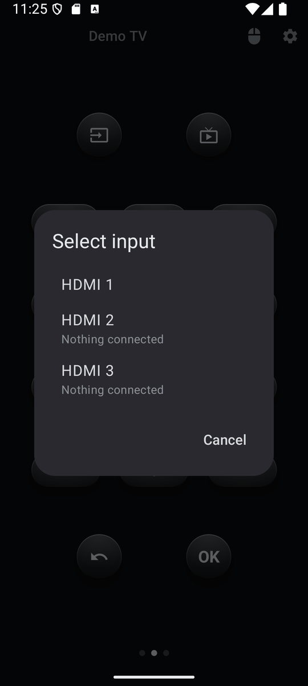

### 4.4 Media and apps


| Key | Function |
|---|---|
| Record (red dot) | Starts a recording (if supported by the TV). |
| Stop / start Live Playback | Ends or starts Live Playback (LG's term for time shift in live TV). |
| Rewind, Pause, Play, Fast forward | Playback control. |
| Directional pad, OK, Back | Navigation as on the first screen. |
| Colour keys | Red, green, yellow, blue. |
| App keys | Up to nine keys that open an app on the TV, see [App keys](#64-app-keys). |

## 5 Pointer

The pointer key in the header opens an overlay above the current screen. In both modes:

- **OK** clicks at the pointer position – several clicks in a row are possible.
- The **close button** (×) at the top right or the back gesture ends pointer mode; the cursor on the TV disappears.
- After 5 seconds without activity, pointer mode ends automatically.

### 5.1 Motion mode

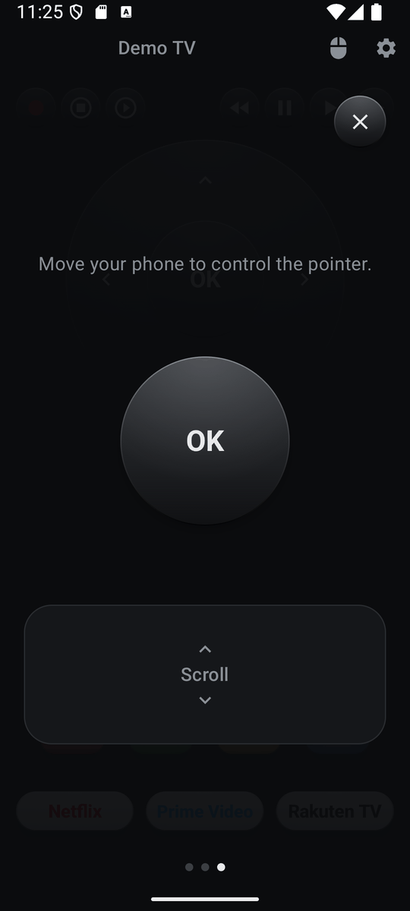

The pointer follows the movements of your phone – like aiming with the Magic Remote. Two ways of holding the phone are supported and recognised automatically:

- **Like a remote** (screen facing up, top edge pointing at the TV): swing left/right, tilt the top edge up/down.
- **Upright in front of you** (back facing the TV): turn left/right around the vertical axis, tilt forwards/backwards.

Twisting the phone around the aiming axis is ignored on purpose because it happens unintentionally while aiming. Sensor data is smoothed; quick swings move the pointer further than slow movements. Swipe up or down on the **scroll area** to scroll.

### 5.2 Touchpad mode

<p>
  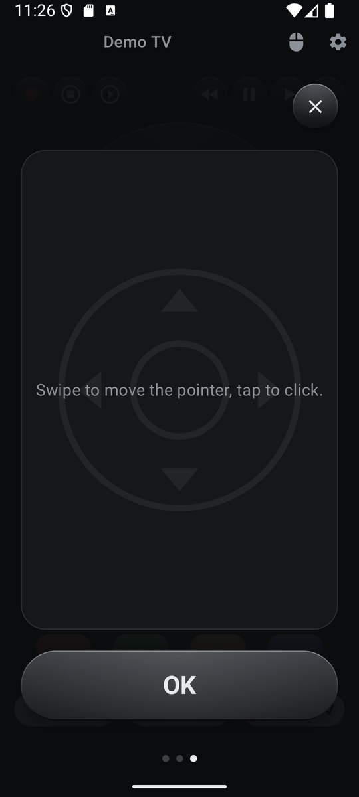
  &nbsp;
  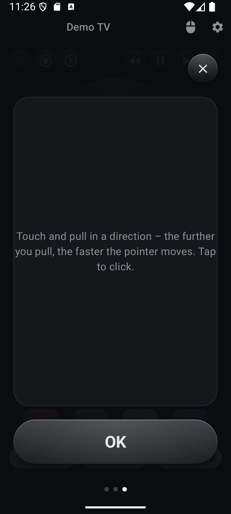
</p>

The pointer is controlled with the touch area. A tap on the area without swiping clicks like OK. Two input styles are available:

- **Swipe** – the pointer follows your finger like on a laptop touchpad.
- **Joystick** – like an analog stick: starting from the first touch point, the further you pull in a direction, the faster the pointer moves.

The OK button can be placed at the bottom (default) or at the top.

## 6 Settings

### 6.1 TV

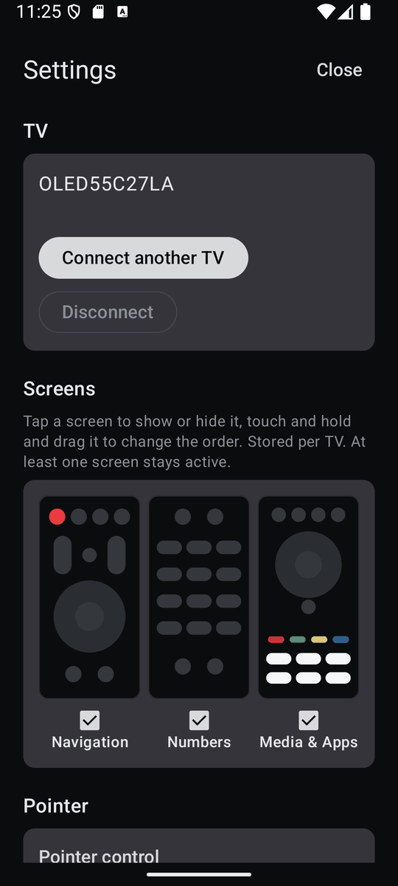

Shows the active TV. **Connect another TV** opens the connection screen, **Disconnect** removes the active TV after confirmation.

### 6.2 Screens

The three screens are shown as simplified previews:

- **Tap** a preview to show or hide the screen.
- **Touch and hold, then drag** to change the order.
- At least one screen always stays active. With only one screen, the page dots disappear.

The selection is stored per TV.

### 6.3 Pointer

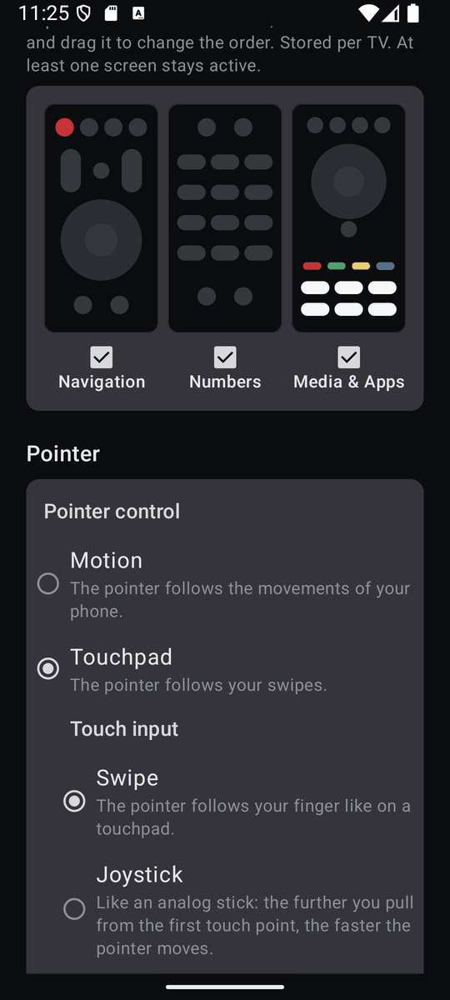

- **Motion** – with the sub-options *Sensitivity* (0.3× to 3.0×) and *Acceleration* (0× to 4×; 0 = no acceleration). Only available if the phone has a gyroscope.
- **Touchpad** – with the sub-options *Touch input* (swipe or joystick) and *OK button* (bottom or top).

### 6.4 App keys

<p>
  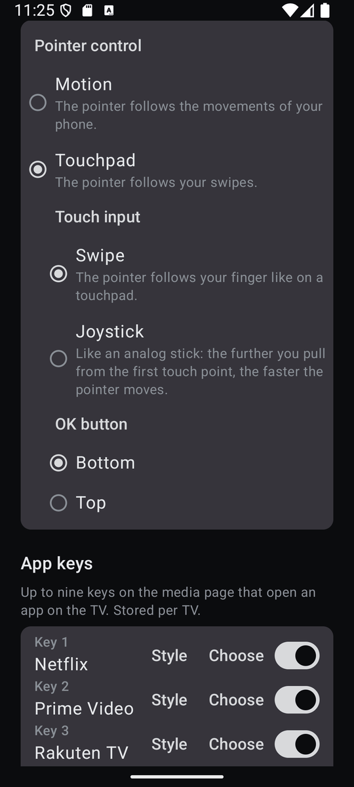
  &nbsp;
  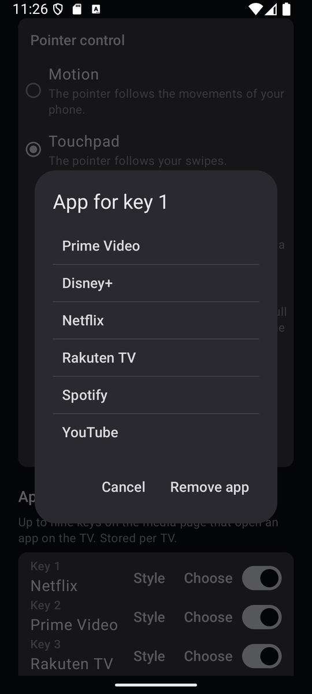
  &nbsp;
  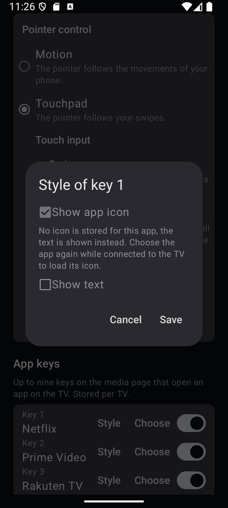
</p>

Up to nine keys on the media screen, stored per TV. For each key:

- **Switch** – shows or hides the key.
- **Choose** – loads the apps installed on the TV and assigns one of them. The app's icon is downloaded from the TV and stored on the phone, so it is also shown without a connection. *Remove app* empties the key.
- **Style** – show the app icon and/or text, enter a custom text (pre-filled with the app name) and pick a text colour. With icon and text, the icon is shown on the left followed by the text. The text shrinks automatically so it always fits the key.

Default assignment: Netflix, Prime Video, Rakuten TV.

### 6.5 Vibration and demo mode

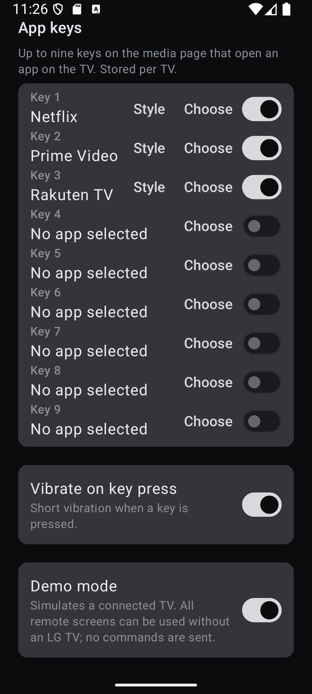

- **Vibrate on key press** – short vibration when a key is pressed (also when clicking in touchpad mode).
- **Demo mode** – simulates a connected TV ("Demo TV"). All screens can be used without an LG TV, no commands are sent. Demo mode has its own app keys and screen selection.

## 7 Building

```
./gradlew :app:assembleDebug
```

Requires JDK 17 or newer and the Android SDK.

## 8 Releases

APKs are built automatically on GitHub:

- Tag `v*` → signed release APK and app bundle, published as a GitHub release.
- Tag `devbuild` → signed APK as a build artifact.
