<p align="center">
  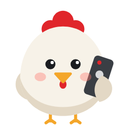
</p>

# Elly

Elly turns your Android phone into a remote control for LG TVs running webOS. It recreates the keys and functions of the original LG Magic Remote – including the pointer, which you control with your phone's motion sensors or a touch area. Elly, a chicken with a remote under her wing, guides you through the app.

> **Status:** early development – searching and pairing, all keys, the pointer, freely configurable screens, widgets and the help work; some key assignments still need to be verified on more TVs.

> Elly is an independent project and is not affiliated with LG Electronics. “LG”, “webOS” and “Magic Remote” are trademarks of their respective owners.

[Deutsche Version](README.de.md)

<p>
  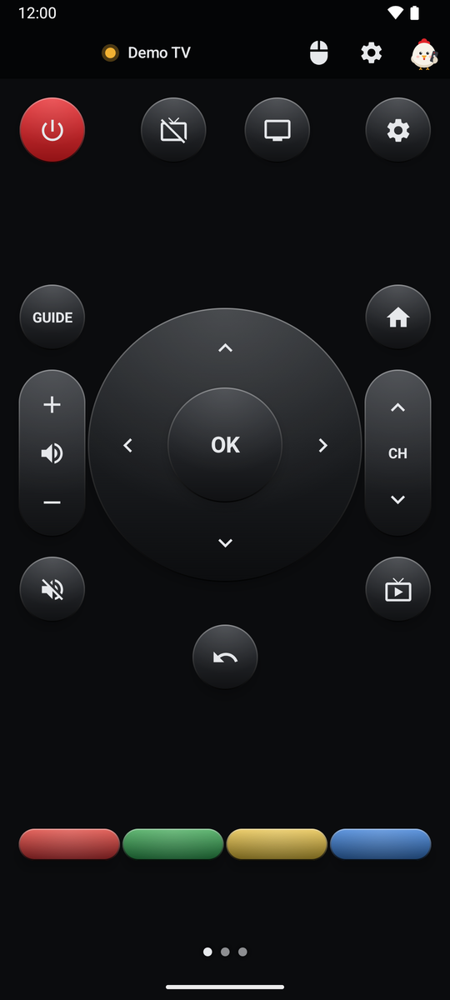
  &nbsp;
  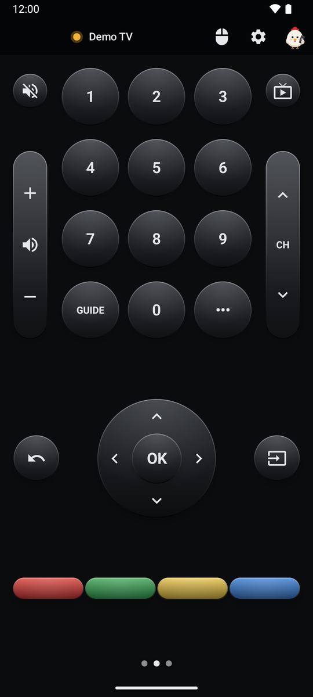
  &nbsp;
  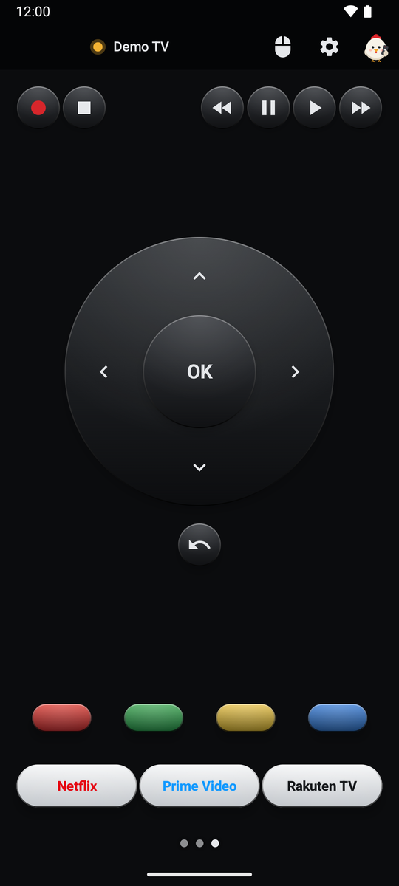
</p>

## Contents

1. [Features at a glance](#1-features-at-a-glance)
2. [Requirements](#2-requirements)
3. [Getting started](#3-getting-started)
   - [3.1 Quick start](#31-quick-start)
   - [3.2 Connecting a TV](#32-connecting-a-tv)
4. [The remote](#4-the-remote)
   - [4.1 Top bar](#41-top-bar)
   - [4.2 Screen 1](#42-screen-1)
   - [4.3 Screen 2](#43-screen-2)
   - [4.4 Screen 3](#44-screen-3)
   - [4.5 Screen 4](#45-screen-4)
   - [4.6 Text input](#46-text-input)
5. [Pointer](#5-pointer)
   - [5.1 Motion mode](#51-motion-mode)
   - [5.2 Touchpad mode](#52-touchpad-mode)
6. [Editing screens](#6-editing-screens)
   - [6.1 Editor](#61-editor)
   - [6.2 Button groups](#62-button-groups)
   - [6.3 App keys](#63-app-keys)
7. [Appearance](#7-appearance)
8. [Widgets](#8-widgets)
9. [Settings](#9-settings)
10. [Help](#10-help)
11. [Privacy](#11-privacy)
12. [Building](#12-building)
13. [Releases](#13-releases)
14. [License](#14-license)

## 1 Features at a glance

- The keys of the LG Magic Remote on up to four screens that need no scrolling – swipe to switch.
- All screens are freely configurable: place, move and resize keys, rockers, the direction pad and app keys in the editor, insert whole button groups and undo step by step.
- Pointer like the Magic Remote: control it by moving your phone or with a touch area (swipe or joystick), optionally opened by shaking or a double tap.
- Text input: when an input field is active on the TV, a text field opens on your phone automatically.
- App keys that open an app on the TV, with the app icon loaded from the TV.
- Input selection with the inputs the TV reports.
- Turn the TV screen off and on again while the sound keeps playing.
- 15 color palettes, twelve backgrounds (including your own photo), adjustable rounding and the “Long summer evenings” light effect.
- Seven home screen widgets, including “Elly remote” with freely selectable keys and its own look.
- Status light in the top bar that shows whether the TV can be reached.
- Quick start on first launch and an extensive help with search – explained by Elly.
- Find TVs on the network, pair them, switch them on via Wake-on-LAN.
- Demo mode for trying everything without an LG TV.
- Available in English and German.

## 2 Requirements

- Android 9 (API 28) or newer. From Android 12 the widgets take on the colors of your wallpaper (Material You); the light effect is available from Android 12.
- An LG TV running webOS on the same network as the phone.
- To switch the TV on: the option “Turn on via Wi-Fi” (“Mobile TV On” on some models) must be enabled on the TV.

## 3 Getting started

### 3.1 Quick start

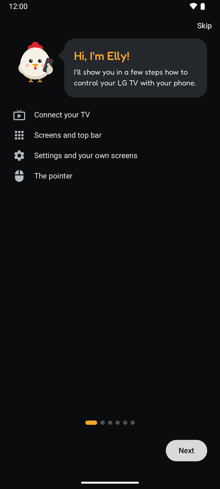

On first launch Elly introduces herself and shows the essentials in six short pages: connecting the TV, screens and top bar, settings and your own screens, and the pointer. **Skip** gets you going right away. You can restart the quick start any time from the [help](#10-help).

### 3.2 Connecting a TV

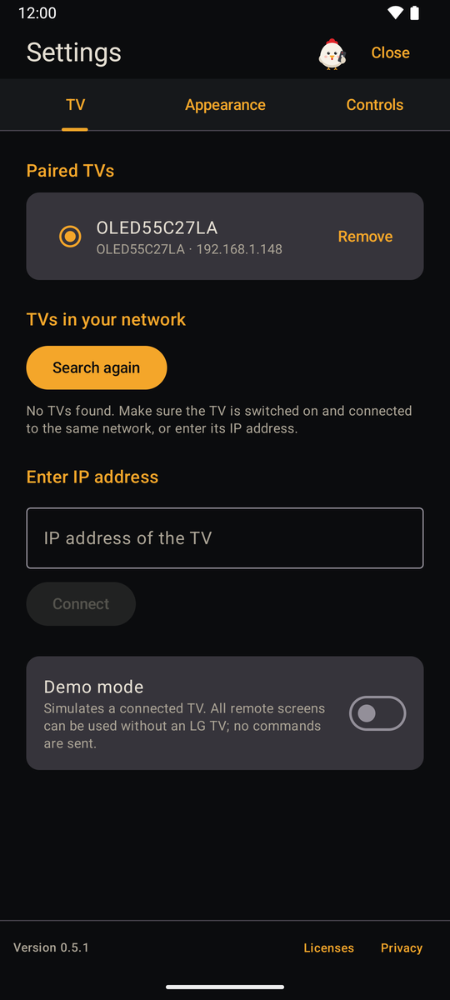

If no TV is paired yet, Elly opens the settings on the **TV** tab and immediately searches the local network:

1. **Search** – found TVs are listed with name, model and IP address. **Search again** runs the search once more.
2. **Enter IP address** – if the search finds nothing, you can enter the TV's IP address manually.
3. **Pair** – tap the TV and accept the connection request on the TV. This is only needed once; Elly confirms the pairing and switches to the remote.

You can pair several TVs. They are listed at the top of the tab under **Paired TVs**: tap one to make it the active TV, **Remove** unpairs it after asking. Elly also remembers the TV's network address (MAC) so it can switch the TV on later. You can reach the **TV** tab any time by tapping the TV name in the top bar. While demo mode is on, the tab only shows the demo mode switch.

## 4 The remote

The following sections describe the default layout. Every screen can be redesigned in the [editor](#61-editor).

### 4.1 Top bar

The top bar is visible on every screen:

- **Status light and TV name** – the light shows the connection state: green connected, red not reachable, grey checking, yellow demo mode. While the app is visible, the connection is checked every 10 seconds and after every command. Tapping the name opens the settings on the **TV** tab.
- **Pointer key** (mouse symbol) – opens the [pointer](#5-pointer). While it is active, the symbol is blue.
- **Gear** – opens the [settings](#9-settings).
- **Elly** at the far right – opens the [help](#10-help). At Christmas (24 Dec to 6 Jan), Easter (Palm Sunday to the Sunday after Easter) and before Halloween (24 to 31 Oct) she wears a matching costume.

The dots at the bottom show the current screen; swipe left or right to switch. Keys only trigger when you lift your finger – a swipe that starts on a key sends nothing. Volume, channel and the direction pad repeat while held.

### 4.2 Screen 1


| Key | Function |
|---|---|
| Power (red) | Turns the TV off; if it cannot be reached, it is switched on via Wake-on-LAN. |
| Screen off / on | Turns only the screen off or on again, the sound keeps playing. |
| Gear | TV settings. |
| GUIDE | Program guide. |
| Home | webOS home screen. |
| Volume rocker, mute | Louder / quieter, sound off / on. |
| CH rocker | Channel up / down. |
| Direction pad and OK | Navigate and confirm. |
| Live TV | Switches to TV reception (antenna, cable, satellite). |
| Back | One step back. |
| Color keys | Red, green, yellow, blue. |

### 4.3 Screen 2

<p>
  
  &nbsp;
  
</p>

| Key | Function |
|---|---|
| 0–9 | Number keys, e.g. for channel numbers. |
| Mute, Live TV | Sound off / on, TV reception. |
| Volume and CH rocker | Louder / quieter, channel up / down. |
| GUIDE | Program guide. |
| ••• | Opens the TV's “More actions” menu. |
| Direction pad, Back | Navigation as on screen 1. |
| Input | Opens a list of the TV's inputs (e.g. HDMI 1, HDMI 2) and switches to the selected one. Inputs without a connected device are marked. |
| Color keys | Red, green, yellow, blue. |

### 4.4 Screen 3


| Key | Function |
|---|---|
| Record (red dot), Stop | Starts a recording (if the TV supports it) or stops playback. |
| Rewind, Pause, Play, Fast forward | Playback control. |
| Direction pad, Back | Navigation as on screen 1. |
| Color keys | Red, green, yellow, blue. |
| App keys | Open an app on the TV, preset with Netflix, Prime Video and Rakuten TV, see [app keys](#63-app-keys). |

### 4.5 Screen 4

The fourth screen starts empty and hidden. Show it in the settings under **Appearance → Screens** and fill it in the [editor](#61-editor).

### 4.6 Text input

When an input field is active on the TV (e.g. a search), a text field with your phone's keyboard opens automatically. The text is sent while you type, the send key works like Enter. The **Keyboard** key, which you can place on a screen in the editor, opens the text field manually. Apps with their own on-screen keyboard (e.g. some streaming apps) do not accept text from the phone.

## 5 Pointer

The pointer key in the top bar opens an overlay on the current screen – the Magic Remote cursor appears on the TV. In both modes:

- **OK** clicks at the pointer position, several clicks in a row are possible.
- The **×** at the top right or the back gesture closes the pointer; the cursor on the TV disappears.
- After 5 seconds without activity the pointer closes automatically.

Choose the mode and all fine-tuning in the settings on the **Controls** tab.

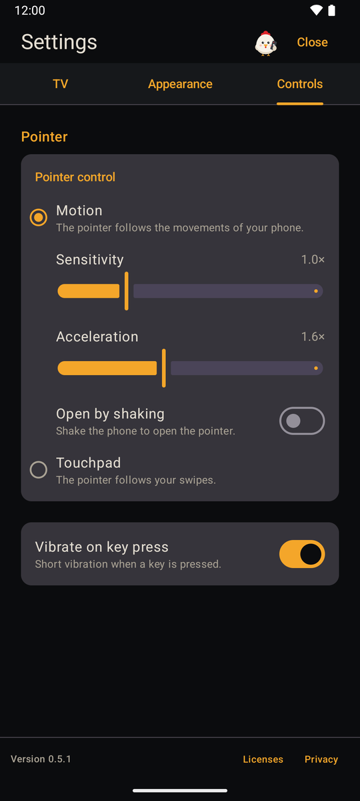

### 5.1 Motion mode


The pointer follows the movements of your phone – just like aiming with the Magic Remote. Two ways of holding it are detected automatically:

- **Like a remote** (screen facing up, top edge pointing at the TV): pan left/right, tilt the top edge up/down.
- **Upright in front of you** (back facing the TV): turn left/right, tilt forward/backward.

Twisting the phone around the pointing direction is ignored so the cursor stays steady. *Sensitivity* (0.3× to 3.0×) and *acceleration* (0× to 4×) are adjustable. Swipe up or down on the **scroll area** to scroll. With **Open by shaking**, a short shake opens the pointer; the shake sensitivity is adjustable. Motion mode needs a gyroscope in the phone.

### 5.2 Touchpad mode

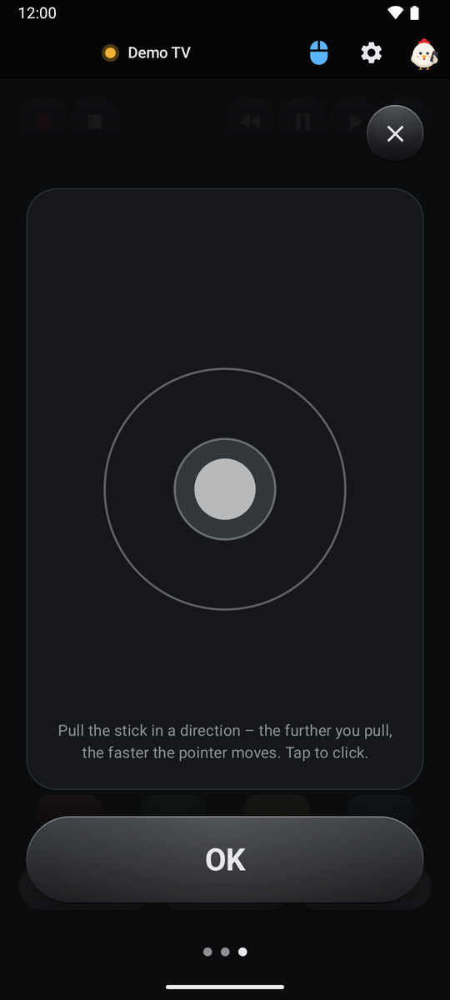

The pointer is controlled with a touch area, a short tap clicks. Two input styles are available:

- **Swipe** – the pointer follows your finger like on a laptop touchpad; the *speed* (0.3× to 3.0×) is adjustable.
- **Joystick** – like an analog stick: the further you pull, the faster the pointer moves. *Free*: the stick starts where you first touch. *Fixed*: the stick is always visible in the middle. The inner circle is the dead zone.

The OK button can sit at the bottom (default) or at the top. With **Open by double tap**, a double tap on a free spot of a screen opens the pointer.

## 6 Editing screens

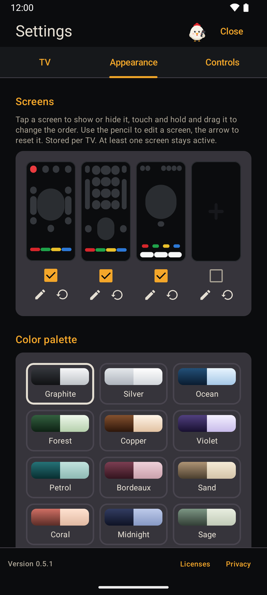

In the settings under **Appearance → Screens** the four screens are shown as previews of their layout:

- **Tap** shows or hides a screen; at least one stays active. With only one active screen the page dots disappear.
- **Long-press and drag** changes the order.
- The **pencil** opens the [editor](#61-editor), the **arrow** resets the screen to its default layout after asking.

The selection and layouts are saved per TV; demo mode has its own.

### 6.1 Editor

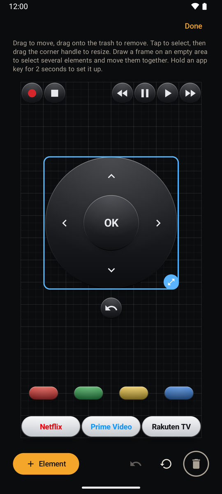

The editor shows the screen's grid (24 × 48 cells) in the proportions of the remote screen.

- **Element** adds a single key, a rocker, the direction pad, an app key or a [button group](#62-button-groups); it lands on the first free spot.
- **Drag** moves an element, **dragging it onto the bin** removes it.
- **Tap** selects an element; the handle at its corner then changes the size.
- **Drawing a frame** on an empty area selects several elements, which can be moved or removed together.
- **Undo** reverts adding, moving, resizing, removing, app key changes and resetting step by step (up to 50 steps; the history starts anew each time you open the editor).
- **Reset** restores the default layout after asking, **Done** saves and closes.

### 6.2 Button groups

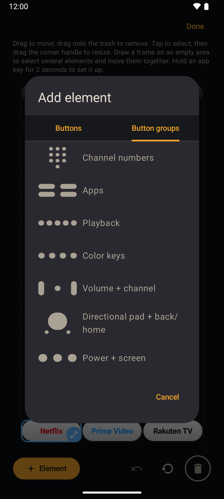

The **Button groups** tab inserts several keys at once: number keys, apps, playback, color keys, volume + channel, direction pad + back/home, and power + screen. The keys have the size of single keys, end up as single elements on the screen and can be centered.

### 6.3 App keys

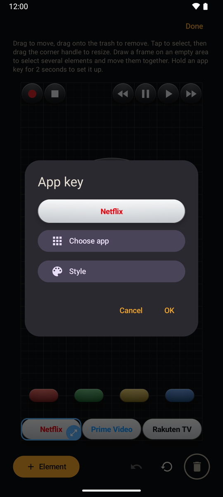

**Hold an app key in the editor for 2 seconds** to open the “App key” window with a preview:

- **Choose app** – loads the apps installed on the TV and assigns one. The app icon is loaded from the TV and stored on the phone.
- **Appearance** – app icon and/or text, your own text and a text color. The text shrinks automatically to fit the key.

If an app key lacks its icon, Elly fetches it as soon as the TV is connected.

## 7 Appearance

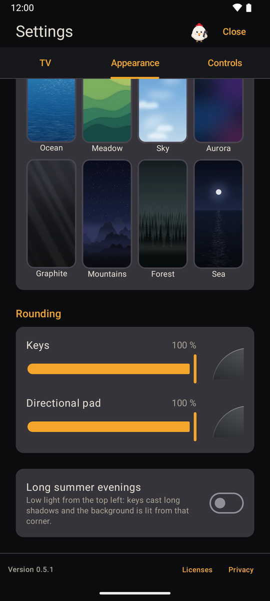

On the **Appearance** tab of the settings:

- **Color palette** – 15 palettes color keys, rockers, the direction pad and app keys: Graphite, Silver, Ocean, Forest, Copper, Violet, Petrol, Bordeaux, Sand, Coral, Midnight, Sage, Ruby, Lagoon and Amber. Power and the color keys keep their colors.
- **Background** – applies to all screens: None, Auto (matching the palette), your own image from the photo picker (scaled proportionally and cropped) or one of the motifs Hills, Ocean, Meadow, Sky, Aurora, Graphite, Mountains, Forest and Sea.
- **Rounding** – two sliders with a corner preview: “Keys” applies to keys, rockers and app keys, “Directional pad” to the ring and the OK key.
- **Long summer evenings** – low light from the top left; the keys cast long, soft shadows to the bottom right and the background brightens from that corner (Android 12 and later).

## 8 Widgets

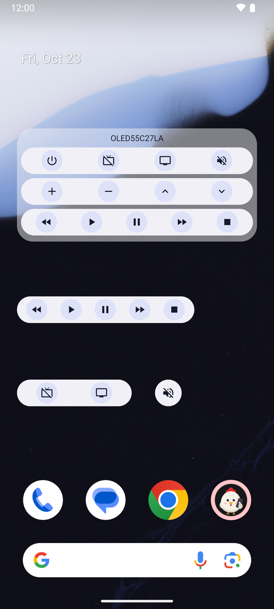

Elly comes with seven home screen widgets:

| Widget | Size | Keys |
|---|---|---|
| Elly volume | 1 × 2, height adjustable | Louder / quieter |
| Elly channel | 1 × 2, height adjustable | Channel up / down |
| Elly playback | 3 × 1, width adjustable | Rewind, play, pause, fast forward, stop |
| Elly power | 1 × 1 | Power |
| Elly mute | 1 × 1 | Mute |
| Elly screen | 2 × 1, width adjustable | Screen off / on |
| Elly remote | 4 × 2, freely adjustable | All keys of the other widgets |

- When you add a widget, Elly asks which TV it should control; change it later in the **widget settings** (long-press the widget).
- **Elly remote** has its own widget settings as well: which keys appear, keys per row (2 to 8), show the TV name, row backgrounds, and color and opacity of the panel behind the rows. The layout rearranges itself depending on the active keys: groups stay together, small groups share a row.
- The app does not need to be open. A key press vibrates if vibration is enabled; if the TV cannot be reached, a message appears.
- From Android 12 the widgets take on the colors of your wallpaper and follow light and dark mode.

## 9 Settings

The gear in the top bar opens the settings. They have three tabs, which you can also swipe between; Elly remembers the last one.

- **TV** – paired TVs, search, IP address and **demo mode**: it simulates a connected TV (“Demo TV”, yellow status light), all screens can be used without an LG TV and no commands are sent. See [connecting a TV](#32-connecting-a-tv).
- **Appearance** – screens, color palette, background, rounding, light effect. See [editing screens](#6-editing-screens) and [appearance](#7-appearance).
- **Controls** – pointer (see [pointer](#5-pointer)) and **vibrate on key press**.

The bottom edge always shows the version number and the links **Licenses** (all open source components used) and **Privacy**. Elly at the top right opens the help.

## 10 Help

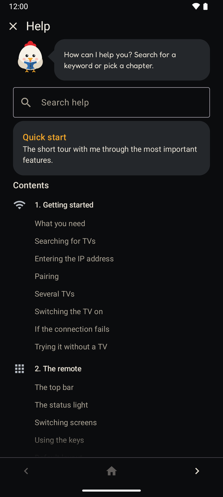

Elly at the far right of the top bar opens the help. It offers:

- a **full-text search** with highlighted matches,
- the **quick start**, which shows the first-launch tour again,
- nine chapters with more than 50 topics, many of them with screenshots.

Swipe between the overview and the chapters or use the fixed footer (previous chapter, overview, next chapter). Every chapter greets you with its own animated Elly scene – from reading a book to the painter at the easel and the judge in the privacy chapter. Mentions of the privacy policy are links.

## 11 Privacy

Elly only talks to your TV on the local network; no data is sent to external servers. Paired TVs, settings, screen layouts and app icons stay on the phone and are deleted when you uninstall the app. The full privacy policy is in the app under **Settings → Privacy**.

## 12 Building

```
./gradlew :app:assembleDebug
```

Requires JDK 17 or newer and the Android SDK.

## 13 Releases

APKs are built automatically on GitHub:

- Tag `v*` → signed release APK and app bundle, published as a GitHub release.
- Tag `devbuild` → signed APK as a build artifact.

## 14 License

Elly is released under the [MIT License](LICENSE). The [Fredoka](https://github.com/hafontia/Fredoka-One) font is licensed under the SIL Open Font License 1.1; AndroidX, Jetpack Compose, Kotlin, kotlinx.coroutines and OkHttp are licensed under the Apache License 2.0. All license texts are available in the app under **Settings → Licenses**.
